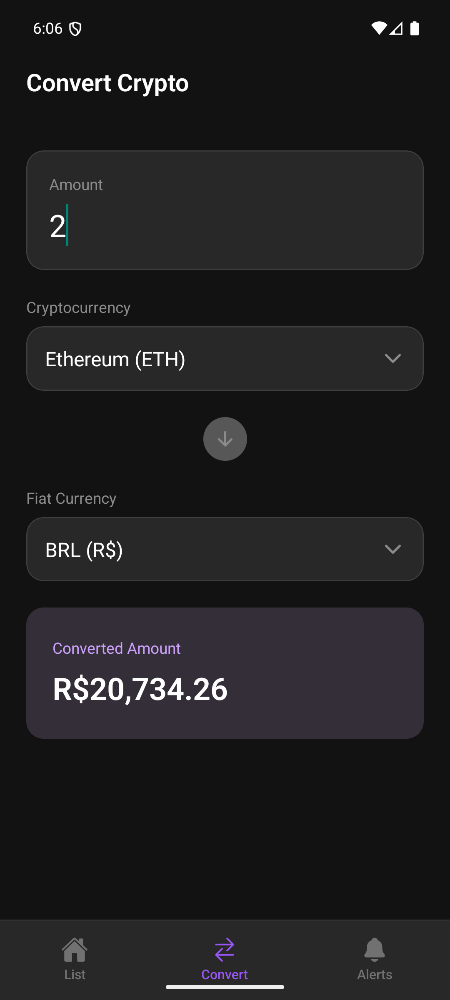
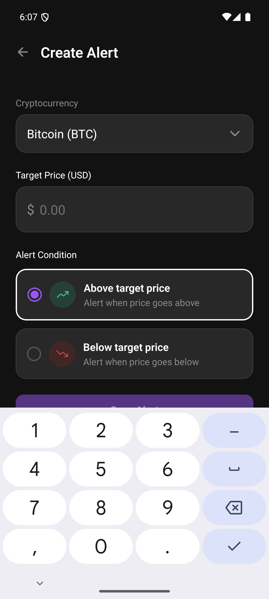
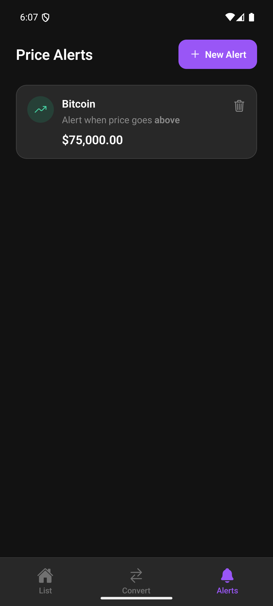
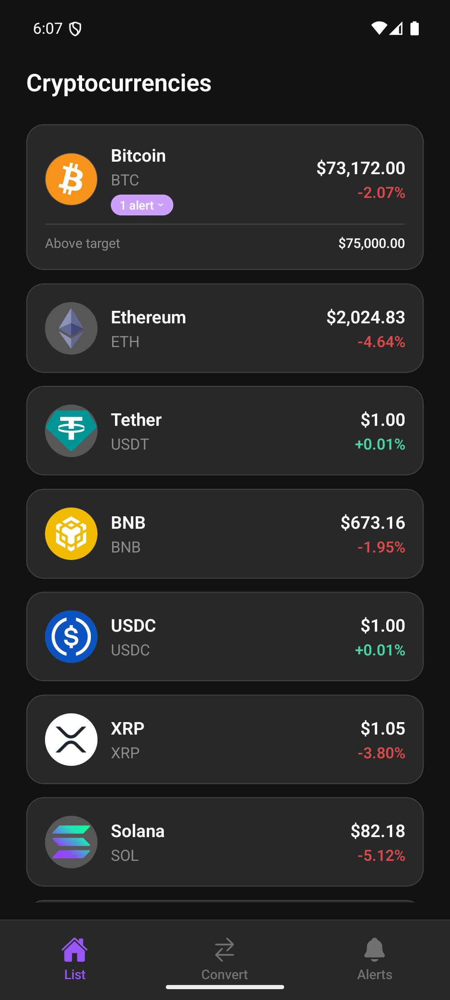

# Crypto Alert — Testes E2E com Maestro e IA Generativa

Atividade para Engenharia de Software III: testes E2E com IA generativa.

- **Aluno:** Mateus de Araujo
- **Professor:** Jeferson Soares
- **Projeto base:** [rocketseat-education/react-native-crypto-alert](https://github.com/rocketseat-education/react-native-crypto-alert)
- **Artigo de referência:** [GenIA-E2ETest: A Generative AI-Based Approach for End-to-End Test Automation](https://arxiv.org/abs/2510.01024)

Usei a IA generativa como apoio para levantar cenários e rascunhar fluxos. Todos os fluxos foram revisados, corrigidos e validados manualmente no aplicativo rodando no emulador Android.

---

## Entregáveis

| Item | Local |
|---|---|
| Reflexão sobre o artigo (Parte 1) | [`reflexao.md`](reflexao.md) |
| Planejamento com IA: prompt, resposta, seleção e análise crítica (Parte 3) | [`ia/planejamento.md`](ia/planejamento.md) |
| Fluxos E2E com Maestro (Parte 4) | [`.maestro/`](.maestro) |
| Evidências da execução | [`docs/evidencias/`](docs/evidencias) |

---

## Pré-requisitos

| Ferramenta | Versão usada | Observação |
|---|---|---|
| Node.js | 24.x | com npm |
| JDK | 17 | exigido pelo Gradle do Android |
| Android Studio + Android SDK | — | com `platform-tools` (`adb`) e `emulator` no `PATH` |
| Emulador Android (AVD) | Pixel 7 | criado em *Device Manager* no Android Studio |
| Maestro CLI | 2.12.1 | ver instalação abaixo |

> No Windows, rode o Maestro pelo **Git Bash** ou pelo **WSL**.

---

## 1. Instalação do projeto

```bash
git clone https://github.com/MateusARJ/Eng-Software-III-E2E.git
cd Eng-Software-III-E2E
npm install
```

Opcional: crie um `.env` a partir do `.env.example` com uma chave demo da CoinGecko. Sem chave, a API pública continua funcionando, mas com limite de requisições menor.

> **Atenção:** os testes precisam de internet. Se a CoinGecko falhar (sem rede ou HTTP 429), a aba **List** mostra "Failed to load" e não a listagem, então os fluxos param na espera por `"Bitcoin"`. Nesse caso, aguarde um minuto e rode de novo.

```bash
cp .env.example .env
```

## 2. Abrir o emulador Android

Pelo Android Studio: **Device Manager → ▶ no AVD**.

Ou pelo terminal:

```bash
emulator -list-avds          # lista os AVDs disponíveis
emulator -avd Pixel_7        # inicia o emulador
adb devices                  # deve listar "emulator-5554  device"
```

## 3. Gerar e instalar a versão nativa do app

O app **precisa estar instalado no dispositivo** antes de rodar os testes. Use a variante *release*: o JavaScript fica embutido no APK e o app não depende do Metro bundler durante os testes.

```bash
npx expo run:android --variant release --no-bundler
```

Para desenvolvimento (com Metro e hot reload), use `npm run android`.

O identificador do app é `com.anonymous.cryptoalert`, definido em `app.json` e usado como `appId` em todos os fluxos.

## 4. Instalar o Maestro

```bash
curl -fsSL "https://get.maestro.mobile.dev" | bash
maestro --version
```

Documentação: <https://docs.maestro.dev>

## 5. Executar os testes E2E

Com o emulador aberto e o app instalado:

```bash
# todos os fluxos
maestro test .maestro/

# um fluxo específico
maestro test .maestro/03-create-alert-and-badge.yaml
```

Cada fluxo começa com `launchApp: clearState: true`, ou seja, limpa o AsyncStorage dos alertas. Assim os fluxos são independentes e podem rodar em qualquer ordem.

Para inspecionar os elementos da tela e descobrir seletores: `maestro studio`.

---

## Fluxos implementados

| # | Arquivo | O que valida |
|---|---|---|
| 01 | [`01-list-and-navigation.yaml`](.maestro/01-list-and-navigation.yaml) | Carregamento da listagem (Bitcoin/Ethereum), navegação entre as abas **List**, **Convert** e **Alerts**, e o estado vazio de alertas |
| 02 | [`02-crypto-conversion.yaml`](.maestro/02-crypto-conversion.yaml) | Conversão reativa: digitar a quantidade, trocar a cripto (BTC → ETH) e a moeda fiat (USD → BRL), conferindo o símbolo `R$` |
| 03 | [`03-create-alert-and-badge.yaml`](.maestro/03-create-alert-and-badge.yaml) | Criação de alerta *Above* para Bitcoin a $75,000.00 e badge **"1 alert"** expansível no card da listagem |
| 04 | [`04-manage-and-delete-alerts.yaml`](.maestro/04-manage-and-delete-alerts.yaml) | Botão **Go back** sem salvar, criação de alerta *Below* para Solana a $120.00 e exclusão pelo botão **Delete alert** |

**Sobre o fluxo 02:** os preços vêm da API da CoinGecko, então o valor convertido muda a cada execução. Por isso o teste verifica o formato (`\$[0-9,.]+`, `R\$[0-9,.]+`) e não um valor exato.

### Decisões de seletores (descobertas na validação no emulador)

- **Espera inicial por `"Bitcoin"`, não por `"Cryptocurrencies"`.** O título aparece já durante o carregamento; a lista só aparece quando a API responde.
- **Abas tocadas por `".*, Convert"`, `".*, Alerts"` e `".*, List"`.** No Android, o texto da aba aparece com altura zero na árvore de acessibilidade, então o Maestro o considera invisível. O botão da aba tem `accessibilityLabel` no formato `"<glifo do ícone>, Convert"`.
- **SelectField: `"Bitcoin \\(BTC\\)"` no campo, `"Ethereum"` no modal.** O campo fechado mostra `nome (símbolo)` (`useSelectField.ts`); no modal, cada opção mostra só o nome.
- **Texto com `$`, `(` e `)` é escapado** (`"\\$75,000\\.00"`), porque o Maestro interpreta o seletor como regex.

---

## Evidências

Execução no emulador Pixel 7 (Android), app em build *release*:

| Arquivo | Conteúdo |
|---|---|
| [`execucao-suite.txt`](docs/evidencias/execucao-suite.txt) | Saída de `maestro test .maestro/`: **4/4 fluxos passando** |
| [`relatorio-junit.xml`](docs/evidencias/relatorio-junit.xml) | Relatório JUnit (`maestro test .maestro/ --format junit`) |
| [`02-crypto-conversion.mp4`](docs/evidencias/02-crypto-conversion.mp4) | Vídeo do fluxo 02 (conversão) |
| [`03-create-alert-and-badge.mp4`](docs/evidencias/03-create-alert-and-badge.mp4) | Vídeo do fluxo 03 (criação de alerta e badge) |

| Fluxo 02: 2 ETH → BRL | Fluxo 03: formulário | Fluxo 03: alerta criado | Fluxo 03: badge na listagem |
|---|---|---|---|
|  |  |  |  |

Para gravar um vídeo novo (no Git Bash, use `MSYS_NO_PATHCONV=1` para o `adb` não converter `/sdcard`):

```bash
adb shell screenrecord /sdcard/fluxo.mp4 &      # inicia a gravação
maestro test .maestro/03-create-alert-and-badge.yaml
adb shell pkill -INT screenrecord               # encerra a gravação
adb pull /sdcard/fluxo.mp4 docs/evidencias/
```

---

## Estrutura

```
.maestro/            fluxos E2E (Maestro)
ia/planejamento.md   planejamento com IA generativa
reflexao.md          respostas sobre o artigo GenIA-E2ETest
docs/evidencias/     capturas e vídeos dos testes
src/                 código do app (Expo Router + React Native)
```
